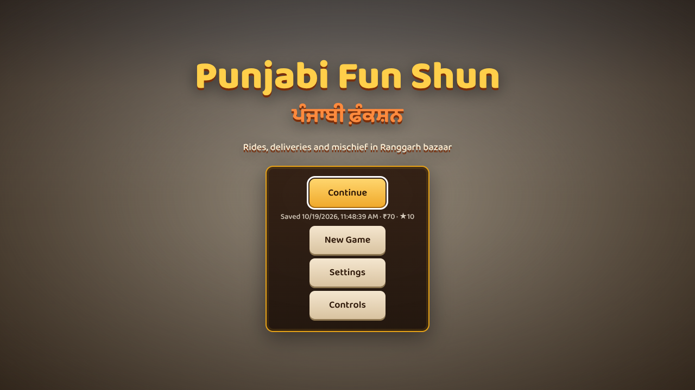
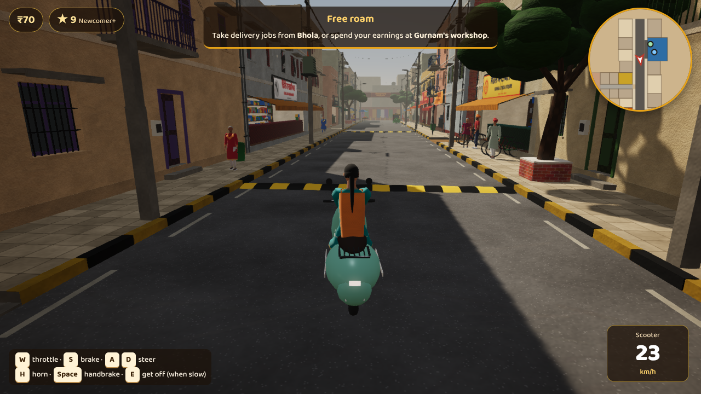
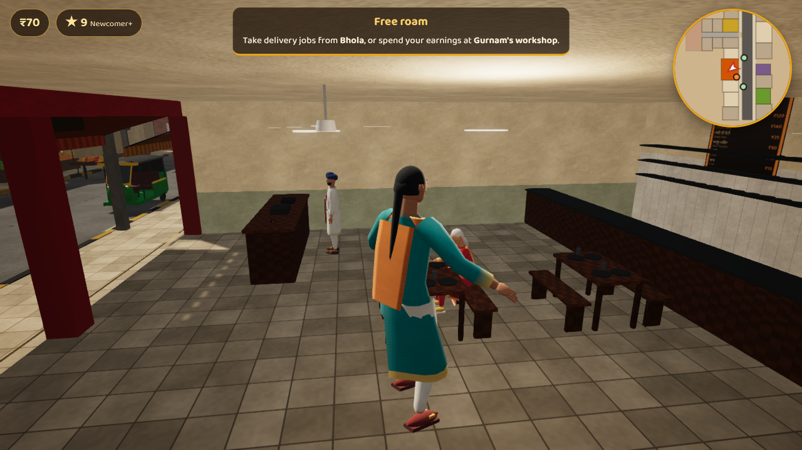
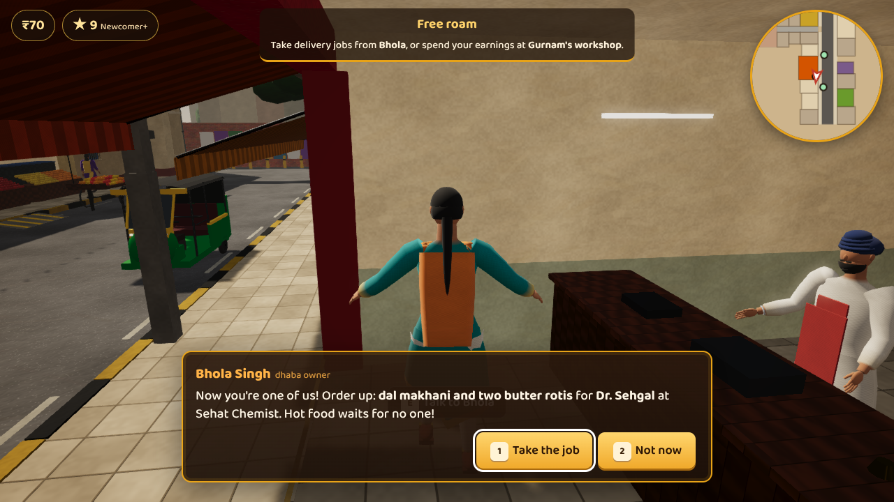
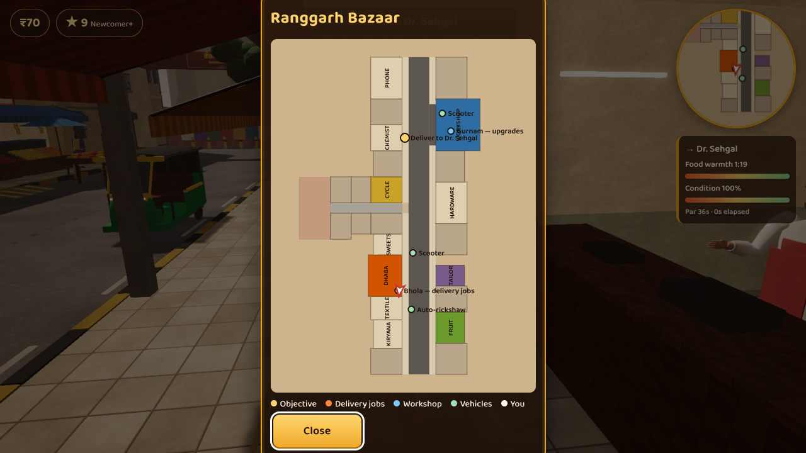
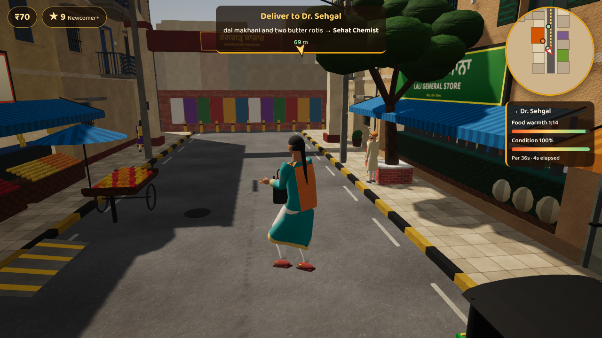

# Punjabi Fun Shun · ਪੰਜਾਬੀ ਫ਼ਨ ਸ਼ਨ

A playful third-person action-adventure sandbox set in **Ranggarh**, a fictional bazaar town in Indian Punjab.
Built from scratch with **Babylon.js 9**, **TypeScript (strict)**, **Vite** and **Havok** physics.
All art and sound are generated by code in this repository (see [`docs/ASSETS.md`](docs/ASSETS.md)); the game runs
fully offline once dependencies are installed.

> **Status: open world** — the walled Ranggarh bazaar (enterable dhaba, workshop, shops) now sits in a
> **1.4 km × 1.4 km countryside**: the G.T. Road with eucalyptus rows, a highway dhaba and petrol pump, the city of
> **Nawan Shehar** (Ghanta Ghar chowk, bus adda, anaj mandi, police chowki, Raj Talkies), **Pind Kotli** village
> (akhada, gurdwara, kabaddi ground), the crowded city of **Ludhiana** down the G.T. Road (Chaura Bazaar, Ghanta Ghar,
> sabzi mandi, auto adda, Deepak Talkies — packed streets, carts on the tarmac and overloaded autos), a canal with
> bridges, farm deras and ~700 fields of wheat, sarson, sugarcane and paddy with kisaan at work. Eight drivable vehicle types, AI traffic, street animals, fights, police, street
> quarrels, a dangal, auto-rickshaw rides and 15 delivery destinations. Remaining ideas: [`docs/BACKLOG.md`](docs/BACKLOG.md).

## Requirements

- Node.js 20+ (tested with 22.22) and npm 10+
- A desktop browser with WebGL2 and WebAssembly (recent Chrome, Edge or Firefox)

## Commands

| Task | Command |
|---|---|
| Install (pinned versions) | `npm install` |
| Development server | `npm run dev` → http://localhost:5173 |
| Type check (strict) | `npm run typecheck` |
| Unit tests | `npm test` |
| Production build | `npm run build` → `dist/` |
| Preview the production build | `npm run preview` → http://localhost:4173 |
| Automated keyboard playtest (needs a running server) | `npm run playtest -- http://localhost:4173/` |

`.npmrc` sets `legacy-peer-deps=true` because npm 10 crashes resolving vitest's optional peer list; versions are pinned exactly.

## Controls

Every keyboard action can be remapped in **Settings → Keyboard** (saved in your browser).

| On foot | |
|---|---|
| `W A S D` or arrow keys | Move (relative to camera) |
| `Shift` | Sprint |
| `Space` | Jump |
| `E` or `F` | Talk · shop · pick up · deliver · ride · break up a quarrel |
| `Q` / left click | Punch, punch, chapet (combo) |

| Riding / driving | |
|---|---|
| `W` / `S` (or `↑` / `↓`) | Throttle / brake — keep holding brake when stopped to reverse (scooter and auto) |
| `A D` (or `←` / `→`) | Steer |
| `Space` | Handbrake |
| `H` | Horn (people step aside) · bell on a bicycle |
| `E` | Get off (when slow) |
| `R` | Recover a flipped or stuck vehicle |

| Camera & menus | |
|---|---|
| Mouse | Look — click the game view to capture the mouse |
| `I J K L` | Rotate the camera without a mouse |
| `C` | Look behind · mouse wheel: zoom |
| `M` / `Tab` | Map (`+` / `−` or the wheel to zoom from the whole countryside down to the bazaar) |
| `Esc` / `P` | Pause: save, map, settings, controls, quit |
| `F1` | Controls reference |

**Gamepad** (standard layout, e.g. Xbox/PlayStation): left stick move/steer, right stick camera, RT/LT throttle/brake,
A jump/handbrake, X interact, B horn, Y recover, RB sprint, LB look back, Start pause, Back map. The D-pad and A/B
navigate menus.

**Phones and tablets**: a floating joystick on the left half, drag the right half to look, a big ✋ button for the
current action, and gas/brake pedals while riding. Play in landscape; the pause menu has a fullscreen toggle.

Settings (pause menu or title): volumes, mute, mouse sensitivity, invert-Y, keyboard camera speed, shadow quality,
post-processing, resolution scale, driving hints, key remapping and a performance overlay. The game pauses and clears
held keys when the window loses focus. Audio starts on your first click, tap or key press (browser autoplay rules).

Shops along the bazaar sell snacks that give short boosts (speed, tips, warmer food), perks such as a bungee cord
that halves spills, and clothes from Masterji and the textile shop. Bhola, Gurnam and Pammi have recorded voice lines.

## What to do out there

- **Deliveries** — Bhola's jobs now go beyond the bazaar walls: the trucker at the highway dhaba, Jarnail Singh's
  dera, the Sarpanch in Pind Kotli, the bus adda, mandi, police chowki, cinema and petrol pump. Longer rides pay more.
- **Sawari (auto rides)** — drive an auto-rickshaw to an auto stand (bus adda or outside the bazaar gate) and pick up a
  passenger. Drive smoothly: every pothole costs you comfort and tips.
- **Vehicles** — scooter, auto-rickshaw, bicycle, motorcycle, hatchback car, open jeep, tractor and truck, parked around
  the map (workshop, dhaba, highway, deras, city). Or walk up to a stopped car in traffic and pull the driver out —
  he will not be happy, and someone will call the police.
- **Ladai-jhagde** — `Q` (or left click with the mouse captured, gamepad B, 👊 on touch) throws a punch–punch–*chapet*
  combo. Neighbours argue in the street: step in to break it up (bich-bachaav) or watch it come to shoving. Lafangas
  loiter at the Ghanta Ghar chowk and the bus adda. Bump someone's car and he climbs out to shout at you.
- **Kotli Akhada** — pay Ustad Kartar ₹20 for a three-bout dangal; knock your man down, stay inside the ring.
- **Police** — constables walk the bazaar and city beat, a naka checks traffic where the Bazaar Road meets the G.T.
  Road, and police jeeps do the rounds. Trouble earns stars (🚨★☆☆): the nearest constables come running, or the
  patrol jeep turns on its siren and chases you. When they catch you,
  it always ends the same way: a little *chai-paani* and they go back to their tea. Escape for long enough and they
  give up.
- **The road itself** — smooth highway, patched link roads, *tooti-footi* stretches full of potholes, and kacha tracks
  with *chikkad* (mud) that drags at your wheels. Stray dogs chase motorbikes, cats dart across, buffaloes stand in the
  middle of the road and ignore your horn, snake-biker youths weave through traffic, and plenty of drivers never stop
  honking (recorded horns and engines: Maruti beeps, scooter peeps, the auto's nasal horn, Bullet thump, diesel chug).
- **Ludhiana** — the loud one, 700 m west down the G.T. Road. Narrow bazaar galis walled by three- to six-storey
  shopfronts, a cart every few metres, aunties holding court on the footpath, four constables on the beat, and autos
  everywhere — crammed with five or six sawaris, one hanging off the footboard. The tarmac is the worst in the game:
  an overloaded auto that takes a pothole at speed slews sideways, and sometimes goes clean over on its side.
- **Street calls** — the sabzi-wala ("Aaloo lo, pyaaz lo!"), the doodhwala, the kabadi-wala, bus conductors and the
  auto touts barking their routes at the stands — "Gill, Gill, Gill!", "Ludhiana, Ludhiana, Ludhiana!". They only call
  when you are close enough to sell to, one at a time, and each seller then holds his tongue for half a minute, so a
  busy market sounds busy without becoming a wall of noise.
- **Gali jhagde** — two aunties will go at each other over a broken gamla, a bakri's milk or whose kachra is whose,
  insults and all, while the neighbours drift over to form a ring and film it. Break it up with a lassi, listen,
  or tell them both they're wrong and find out what that costs.
- **The black Safari** — bump the wrong jeep and the tinted window comes down: *"Kanjar da put, hun paise nai dene
  tere!"* He does not want your ₹50. He wants an apology.
- **Roadside life** — scooters and autos squeeze through the bazaar, tractors haul trolleys of ganna, toori or bricks,
  doodhwalas ride with milk cans, truckers rest by their trucks at the dhaba and one is stuck with a broken spring on
  the G.T. Road. Rehri-walas sell sabzi, fruit, gol gappe and ganne da ras at the roadside; farmers, nihang singhs and
  school kids walk the shoulders.

## Graphics: Low, Medium, High and Ultra

The game asks once, before the title screen, which to use — and it is in **Settings → Graphics** after that. One
choice moves everything that costs frames or battery: shadow maps, post-processing, **render resolution**, draw
distance, how much traffic, how many autos, animals and street folk are simulated, how many engines may sound at
once, and a frame cap.

| | Low | Medium | High | Ultra |
| --- | --- | --- | --- | --- |
| Shadows / post | off / off | hard / off | soft / on | sharp / on |
| Resolution | 60% | 75% | 100% | 100% |
| Draw distance | 220 m | 320 m | 420 m | 650 m |
| Traffic · autos | 9 · 3 | 13 · 5 | 18 · 7 | 30 · 12 |
| Engines heard | 4 | 5 | 6 | 9 |
| Frame cap | 30 fps | 45 fps | — | — |

Phones and tablets default to **Low**. If your phone gets hot, that is the one to use: the frame cap matters more
than anything else, because a device allowed to render 55 fps and then throttle to 25 runs hotter than one held
steadily at 30. The individual controls below the preset still work — changing the preset resets them.

## Getting about: the stand

The district is 1.4 km across and Ludhiana is a long way west, so the HUD has a **🚌 Stand** button: a bus or shared
auto to any of fifteen famous places — the bazaar gate, Bhola's dhaba, the highway dhaba and pump, the Nawan Shehar
bus adda, chowk, mandi and Raj Talkies, Ludhiana's adda, Ghanta Ghar, Chaura Bazaar and sabzi mandi, Pind Kotli,
the akhada and the gurdwara. You pay a fare by distance. It is refused while a delivery is on the clock, while a
sawari is in your auto, while you are driving, and while the police want a word.

## Introductory mission guide — “Pehla Kamm” (first job)

1. **Meet Bhola** — walk into *Bhole Da Dhaba* (red sign, west side) and press `E` at the cash counter.
2. **Collect the tiffin** — walk to the kitchen pass at the back of the dhaba and press `E`.
3. **Find a ride** — the mint scooter is parked by the dhaba; the green-and-yellow auto is just south of it. Press `E`.
4. **Deliver to Gurnam Motor Works** — follow the gold route on the minimap north to the open workshop on the east side.
   Crashes and hitting speed breakers fast spill the dal. Stop in the yellow ring and press `E`.
5. **Reward** — Gurnam pays ₹200 and +10 reputation and unlocks her shop.
6. **Spend it** — talk to Gurnam for brake pads, softer tyres and paint jobs.
7. **Repeatable jobs** — talk to Bhola for delivery orders to seven destinations around the street, lane and courtyard.
   Each has a par time, a food-condition meter, bronze/silver/gold medals and a personal best.
   If the food goes cold or spills, nothing is lost — go back to Bhola for another order.

Steps 6–9 of the full specification (power challenge, vehicle improvement choice, helicopter flight intro) are
Milestone 2–3 items; the workshop shop already provides the "spend a reward on an improvement or cosmetic" loop.

## Project layout

See [`docs/ARCHITECTURE.md`](docs/ARCHITECTURE.md) for the feasibility assessment, module map and simulation order.
Test results, performance measurements and known issues are in [`docs/TESTING.md`](docs/TESTING.md).

## Screenshots (actual gameplay, captured by the automated playtests)

Default graphics, 1280×720 (software-rendered in the test container):

| | |
|---|---|
|  |  |
|  |  |
|  |  |

More (low-graphics test mode, 960×540) in [`docs/screenshots/`](docs/screenshots/): meeting Bhola, carrying the tiffin,
riding to the workshop, Gurnam's dialogue and shop, the delivery HUD with food warmth/condition, the pause menu,
Continue on the title screen and the auto-rickshaw.
