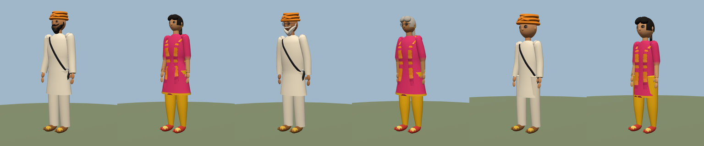
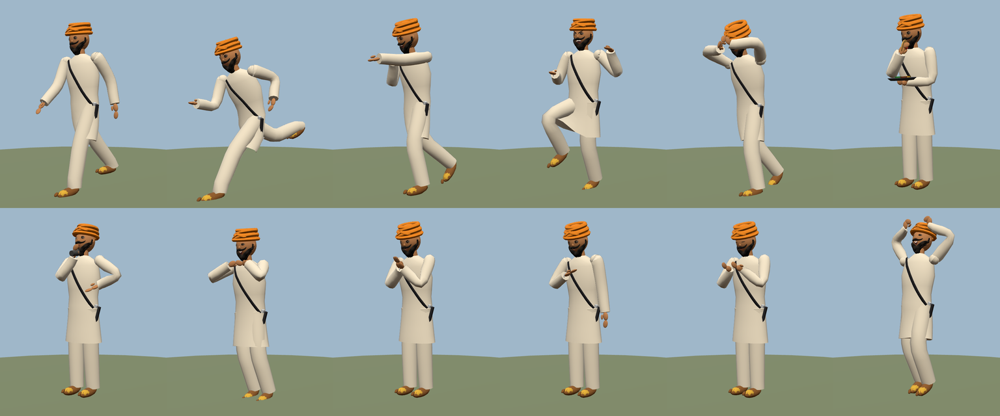

# Punjab Characters

Six fully rigged, procedurally generated Punjabi characters for **Three.js + TypeScript** browser games. No texture or model downloads: the meshes, skeleton, skin weights, face morph targets, outfits and animations are all built in code. A character costs about 5-9k triangles, 2 draw calls (body + face) and one 31-bone skeleton.




## Characters

| Archetype | Id | Notes |
|---|---|---|
| Man | `male` | Sikh man with dastar, beard and moustache |
| Woman | `female` | Braid with paranda, dupatta, jewellery |
| Uncle | `uncle` | Elder: white beard, slower tempo, slight hunch |
| Aunty | `aunty` | Elder: grey hair, glasses, slower tempo |
| Boy | `boy` | Kid proportions, patka or school uniform |
| Girl | `girl` | Kid proportions, pigtails |

Every character has the same 31-bone humanoid skeleton (hips, spine, chest, neck, head, shoulders, arms, hands, fingers, thumbs, legs, feet, plus secondary chains for the braid and cape/dupatta), and 13 face morph targets (blink, squint, brows up/angry/sad, smile, open, round, frown, shout, chew and more).

## Outfits (the "city population" selector)

Man / Uncle: Kurta Pajama + Dastar, Festive Nehru Jacket, **Punjab Police**, **Businessman**, Kisan (farmer), Bhangra performer, Gurdwara sewadar, Dhaba cook, College student, Kabaddi player, Nihang Singh, Winter uncle.
Woman / Aunty: Patiala Suit, Giddha, **Punjab Police (F)**, **Business (F)**, College girl, Village woman, Bridal, Winter aunty, Sewadar (F).
Boy / Girl: Kurta pajama, Festive, Bhangra, Sewadar, Student, School uniform, Kabaddi, Giddha, College-style, Village.

Outfit colours (top, bottom, turban, dupatta, jacket) and skin tone are overridable at runtime.

## Animations (30 clips)

`idle walk run jump talk bhangra hit_react die sit sat_sri_akal wave salute clap cry angry eat drink_chai giddha fight_idle punch kick block victory pray point laugh shrug`

Hands are placed with a built-in IK solver, so greeting (hands together at the chin), salute (right hand to the brow), eating (thali in the left hand, roti to the mouth), chai (glass to the lips) and punches/kicks land where they should on every body type. Clips carry a facial expression, mouth talk/chew flapping and temporary props (thali, roti, chai glass) automatically.

## Use in your game

```ts
import * as THREE from 'three';
import { Character, Crowd, POPULATIONS } from './lib';

const hero = new Character({ archetype: 'male', outfit: 'police', colors: { head: '#1d3f8a' } });
scene.add(hero.root);
hero.play('walk');                       // cross-fades automatically
hero.play('sat_sri_akal', { restart: true });
hero.faceCtl.set('happy');               // expression
hero.setOutfit('business');              // swap outfit at runtime
hero.speedFor('run');                    // m/s the run clip is authored for (drive root motion yourself)

function frame(dt: number) { hero.update(dt); }
```

One-shot clips (greeting, punch, kick, salute...) stop on their last pose; check `hero.finished` and then `play('idle')`.

### Population / crowd

```ts
const crowd = new Crowd({ minX: -6, maxX: 6, minZ: -26, maxZ: 12 });
crowd.obstacles = [{ x: 0, z: -2, r: 1.5 }];
scene.add(crowd.group);
crowd.spawn('wedding', 40);              // bazaar | police | wedding | gurdwara | campus | village
function frame(dt: number) { crowd.update(dt); }
```

Agents wander, avoid each other and obstacles, chat, dance, eat, pray and greet each other with Sat Sri Akal when they meet. Each outfit has its own signature actions (police salute and point, Nihang fight stance, kids run and jump, and so on).

## Files

- `src/lib/` the character kit (import from `src/lib/index.ts`)
- `src/demo/` the Amritsar bazaar demo scene (procedural shops, gurdwara, chai stall, bunting)
- `dist-models/*.glb` the six characters exported with skeleton, 13 face morph targets and all 30 clips, for use outside this kit (default outfits)
- `dist-models/community/*.glb` 16 more ready-made characters from the non-Sikh outfits (Hindu, Muslim, Christian and everyday wear)
- `tools/` the Playwright scripts used for the preview sheets

## Run

```bash
pnpm install
pnpm dev        # demo at http://localhost:5173
pnpm build      # static build in dist/
```

Demo controls: WASD to move, Shift to run, Space to jump; G greet, H wave, F punch, K kick, B block, E eat, T chai, N bhangra, C clap, X fall, L laugh, P pray, R salute. On touch devices a joystick and buttons appear.

## Notes and limitations

- Style is deliberately low-poly and stylised. Faces use morph targets rather than bones, so GLB consumers need morph target support (three.js, Babylon, Godot 4 and Unity all have it).
- The GLB files contain the default outfit only. Swapping outfits needs the TypeScript kit.
- Gurmukhi text in the demo signs uses the system font (Noto Sans Gurmukhi, Nirmala UI).


## Communities, greetings and new outfits (v2)

Punjab's cities are home to Sikh, Hindu, Muslim and Christian families, so the kit now ships outfits for all of them. Every outfit has a `community`
(`communityOf(outfit)`), and the runtime picks the right greeting automatically:

| Community | Greeting clip | Line |
|---|---|---|
| Sikh | `sat_sri_akal` | ਸਤਿ ਸ੍ਰੀ ਅਕਾਲ! |
| Hindu | `namaste` | ਨਮਸਤੇ ਜੀ! |
| Muslim | `salaam` (hand on heart + nod) | ਸਲਾਮ! Assalamu alaikum |
| Christian / everyday | `wave` | spoken line only |

```ts
const c = new Character({ archetype: 'uncle', outfit: 'pandit' });
c.community;          // 'hindu'
const line = c.greet(); // plays 'namaste', returns the speech-bubble text
```

New outfits (all editable with the colour tweaks): Diwali Kurta + Tilak, Pandit ji, Eid Kurta + Topi, Imam Sahib (pagri), Punjabi Pagri Farmer, Neta ji (Gandhi cap),
Office Casual (stubble), Street Casual, Police with peaked cap, Church Sunday Best (man and woman), School uniform without patka, Diwali Anarkali suit (bindi, sindoor,
mangalsutra), Saree, Eid suit with hijab-style wrap, Kurti and Jeans. New clips: `namaste`, `salaam`, `dua`. New head-wear: `topi`, `gandhi`, `pagri`.
Men without a turban get proper hair (`crop`, `sidepart`, `balding` for elders) and facial-hair styles (`facial: 'full' | 'trim' | 'sunnah' | 'stubble' | 'moustache' | 'none'`).
Population preset `mohalla` mixes all communities; the default `bazaar` crowd also includes them.

### Arm-collision guard
All clips are post-processed by `guardArms` when baked: it searches the elbow swivel for a pose that keeps the forearm and hand outside the torso/clothing,
and clamps wrist swing so hands never bend back. `tools/audit.py` reports penetration (cm) and elbow/wrist ranges for every clip; after the fix every clip
stays within ~0.5 cm of the body surface on all six body types. The bake takes 0.2-0.4 s per body type once and is cached.
